<a id="top"></a>

<div align="center">


# Sprucetrap · Constellations

**A cybersecurity × full-stack portfolio you scroll through like a flight across the night sky.**


[](https://github.com/Jevoel16/Portfolio/actions/workflows/ci.yml)


[About](#about) · [Screenshots](#screenshots) · [Features](#features) · [Tech Stack](#tech-stack) · [Getting Started](#getting-started) · [Usage](#usage) · [More](#more) · [Contributing](#contributing) · [License](#license) · [Author](#author)

</div>

---

## About

My personal portfolio and blog, built as an interactive 3D night sky: every skill is a constellation, every project is a star, and Spruce, a holographic guide, answers in the Contact section. It shows recruiters and collaborators my cybersecurity and full-stack work in one place. Live at **[jevoelorbilla.dev](https://www.jevoelorbilla.dev)**.

<p align="right"><a href="#top">back to top ↑</a></p>

---

## Screenshots

<details>
<summary><b>Screenshots</b></summary>

<table>
<tr>
<td width="50%" align="center"><b>Home</b><br><a href="docs/images/home-sky.webp">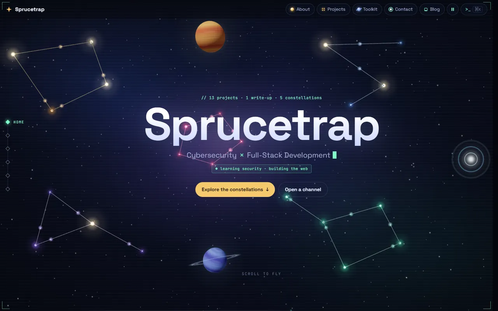</a></td>
<td width="50%" align="center"><b>About</b><br><a href="docs/images/about.webp">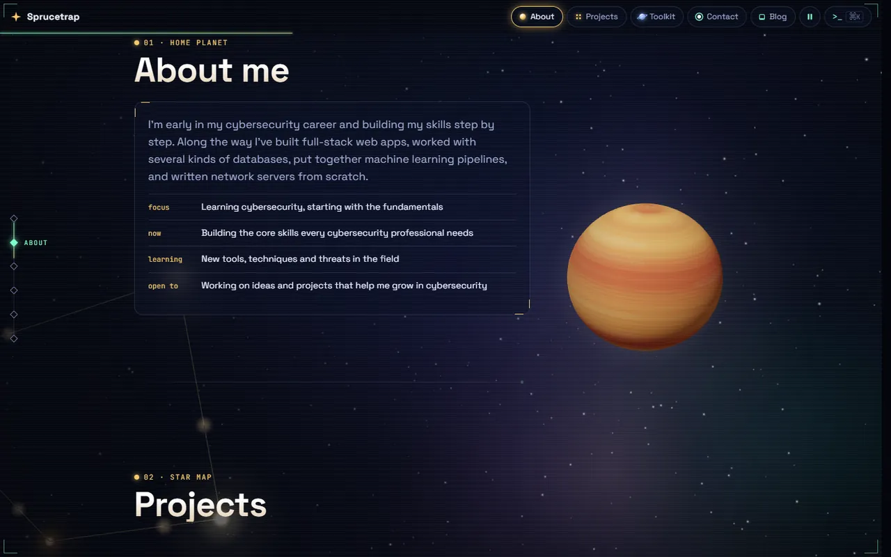</a></td>
</tr>
<tr>
<td width="50%" align="center"><b>Projects</b><br><a href="docs/images/projects.webp">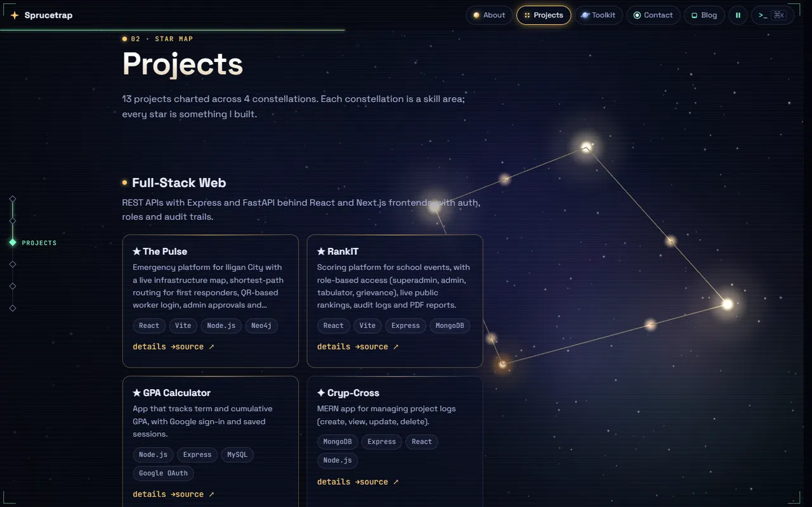</a></td>
<td width="50%" align="center"><b>Toolkit</b><br><a href="docs/images/toolkit.webp">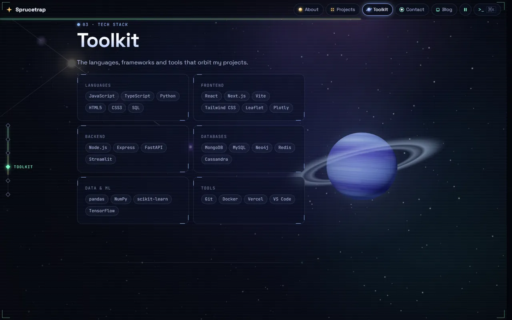</a></td>
</tr>
<tr>
<td width="50%" align="center"><b>Contact with Spruce</b><br><a href="docs/images/contact-spruce.webp">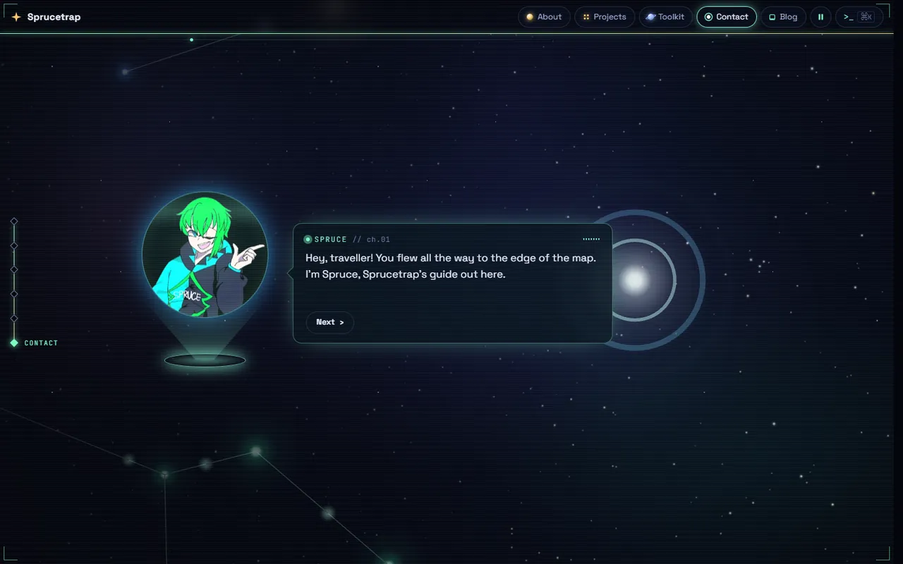</a></td>
<td width="50%" align="center"><b>Command terminal</b><br><a href="docs/images/terminal.webp">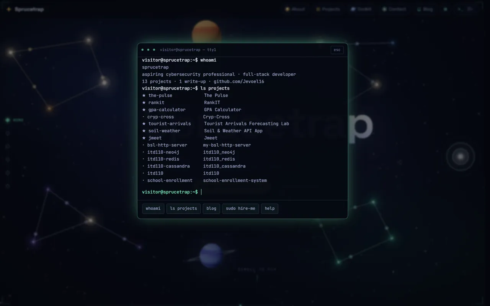</a></td>
</tr>
<tr>
<td width="50%" align="center"><b>Project page</b><br><a href="docs/images/project-page.webp">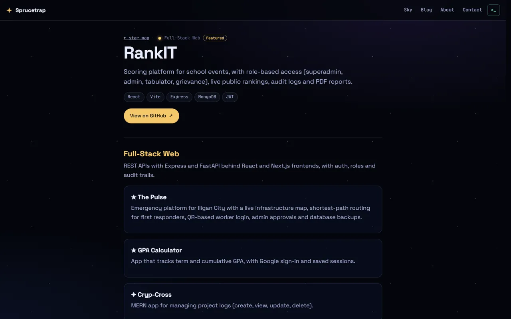</a></td>
<td width="50%" align="center"><b>Blog</b><br><a href="docs/images/blog-index.webp">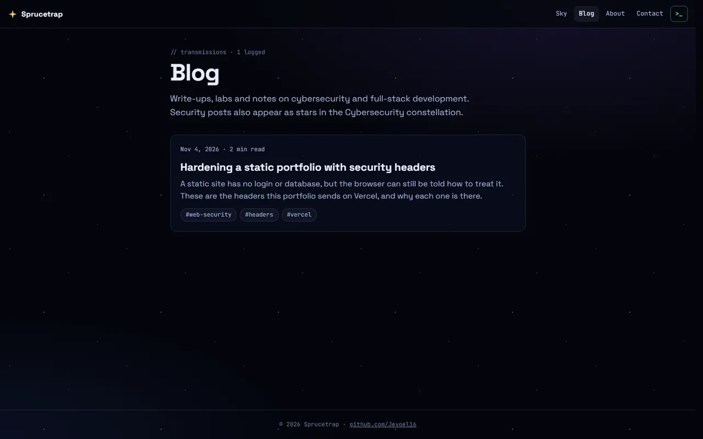</a></td>
</tr>
<tr>
<td width="50%" align="center"><b>Blog post</b><br><a href="docs/images/blog-post.webp">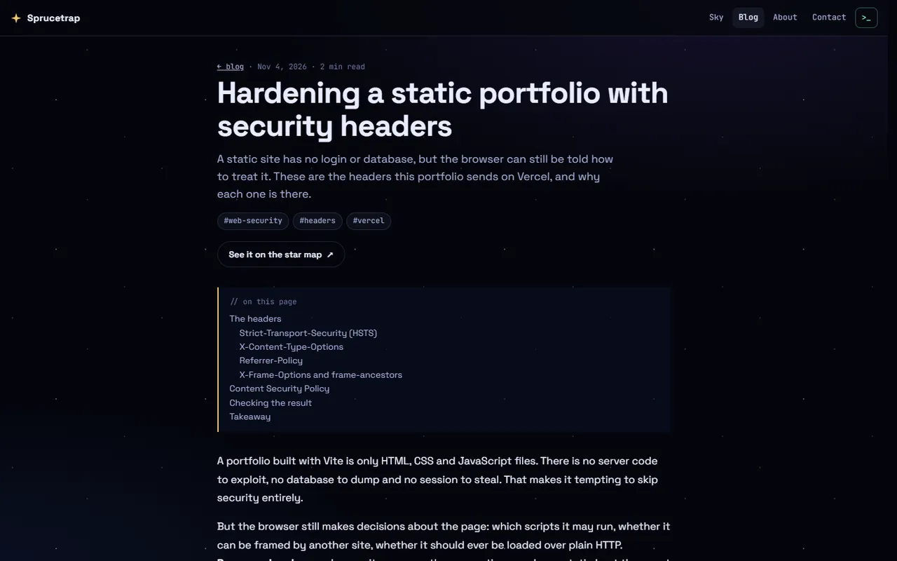</a></td>
<td width="50%" align="center"><b>No-WebGL fallback</b><br><a href="docs/images/static-fallback.webp">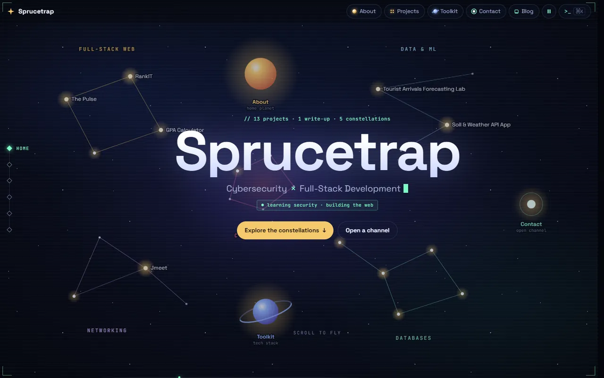</a></td>
</tr>
<tr>
<td width="50%" align="center"><b>Phone (home and Contact)</b><br><a href="docs/images/phone.webp">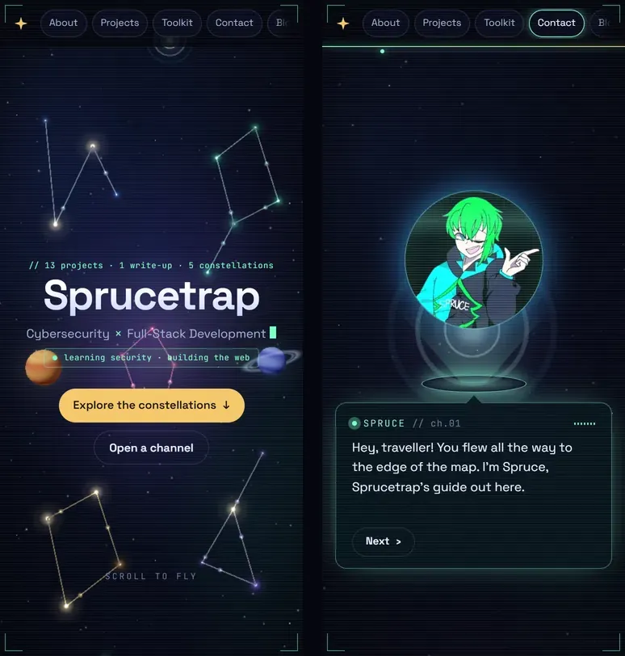</a></td>
<td width="50%"></td>
</tr>
</table>

</details>

<p align="right"><a href="#top">back to top ↑</a></p>

---

## Features

- Scroll to fly the camera from the full sky to each section's planet or constellation.
- Browse projects as stars grouped into skill constellations, each with its own page.
- Meet Spruce, a holographic guide who talks you through the Contact section.
- Navigate by keyboard with a `Ctrl+K` command terminal (`whoami`, `ls projects`, `open <slug>`).
- Read security write-ups and notes on a fast, prerendered blog.
- Use it comfortably on phones, with screen readers, or without WebGL.

Full details: [docs/features.md](docs/features.md).

<p align="right"><a href="#top">back to top ↑</a></p>

---

## Tech Stack

| Layer | Tools |
| --- | --- |
| UI | React 18.3.1, TypeScript 5.6.3, React Router 7.18.5 |
| 3D | three.js 0.170.0, React Three Fiber 8.18.0, drei 9.122.0 |
| Build and blog | Vite 6.4.5, marked 15.0.12, Shiki 3.23.0, prerendered with `renderToString` |
| Testing | Vitest 5.1.0 |
| Hosting | Vercel with Vercel Web Analytics 2.0.1, GitHub Actions CI |

<p align="right"><a href="#top">back to top ↑</a></p>

---

## Getting Started

Requires Node.js 22.12 or newer (see `.nvmrc`) and npm.

```bash
git clone https://github.com/Jevoel16/Portfolio.git
cd Portfolio
npm install
npm run dev        # http://localhost:5173
```

<p align="right"><a href="#top">back to top ↑</a></p>

---

## Usage

1. Scroll, or use the header chips and the left-hand rail, to fly between About, Projects, Toolkit and Contact.
2. Open a project's **details →** for its page, or **source ↗** for its repository.
3. Press `Ctrl+K` (or `/`) for the terminal and type `help`.
4. Add a blog post by creating `content/posts/<slug>.md`.

Guides: [using the site](docs/usage.md) · [editing content and writing posts](docs/content.md) · [deployment, SEO and analytics](docs/deployment.md).

<p align="right"><a href="#top">back to top ↑</a></p>

---

## More

<details>
<summary><b>Project structure</b></summary>

```text
Portfolio/
├── .github/workflows/   # CI (audit, test, build) and post-deploy smoke test
├── content/posts/       # Blog posts in Markdown
├── docs/                # Guides, README logo and screenshots
├── plugins/             # Vite plugin that compiles posts at build time
├── public/              # Icons, manifest, share image, robots.txt, Spruce avatar
├── scripts/             # Prerender (pages, sitemap.xml, llms.txt) and smoke test
├── src/                 # App: pages, components, HUD, scroll, 3D scene, SEO, data
└── vercel.json          # Clean URLs, security and cache headers
```

</details>

<details>
<summary><b>Scripts</b></summary>

| Command | Description |
| --- | --- |
| `npm run dev` | Start the Vite dev server on port 5173 (also on your LAN) |
| `npm run build` | Type-check, build, then prerender every route plus `sitemap.xml` and `llms.txt` into `dist/` |
| `npm run preview` | Serve the production build locally |
| `npm test` | Run the Vitest suite once |
| `npm run test:watch` | Run Vitest in watch mode |
| `npm run smoke` | Smoke-test the live site (`npm run smoke -- <url>` for another deploy) |

</details>

<p align="right"><a href="#top">back to top ↑</a></p>

---

## Contributing

Branch as `feat/…` or `fix/…` and use [Conventional Commits](https://www.conventionalcommits.org/) ending with the bumped SemVer version, e.g. `feat: add CSV export (v1.4.0)`. Run `npm test` and `npm run build` first, and update this README (and its screenshots in `docs/images/`) with every change.

<p align="right"><a href="#top">back to top ↑</a></p>

---

## License

Released under the [Sprucetrap Source-Available License 1.0](LICENSE): free for non-commercial use with visible credit.

<p align="right"><a href="#top">back to top ↑</a></p>

---

## Author

**Sprucetrap** ([@Jevoel16](https://github.com/Jevoel16)), personal portfolio.

<p align="right"><a href="#top">back to top ↑</a></p>
